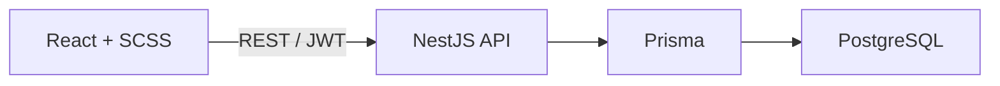

# Stockroom — Inventory & Orders

A React + TypeScript storefront and operations dashboard backed by a NestJS REST API,
Prisma, and PostgreSQL. All styling uses **SCSS**, with no Tailwind dependency. The supplied
`Inventory_Orders_Service_Detailed_Roadmap.pdf` is the implementation brief.

Customers can browse/search/filter products, inspect details, register/sign in, manage a
cart, place orders, and view/cancel their own pending orders. Administrators can create,
edit, archive/restore products, update stock, inspect incoming orders, and confirm or
cancel pending orders. Amounts use integer kobo; the UI displays Nigerian naira.



## Local setup

Prerequisites: Node.js 22.12+ (Node 22 LTS recommended), npm, and PostgreSQL. Docker is
optional if using a hosted database. On PowerShell with scripts disabled, use `npm.cmd`
in place of `npm`.

```sh
npm ci
# Copy .env.example to .env and set DATABASE_URL.
# Optional local PostgreSQL:
docker compose -f infra/docker-compose.yml up -d db
# Generates missing JWT and seed secrets in .env without printing them:
node scripts/configure-local.cjs
npm run db:generate
npm run db:migrate
npm run db:seed
npm run dev
```

If `.env` already exists, preserve its database URL. The configuration script only appends
missing secrets. Seed is idempotent: it adds missing sample products/accounts without
resetting existing passwords or inventory. Never run demo seeding in production.

- Frontend: <http://localhost:5173>
- API: <http://localhost:4000/api/v1>
- OpenAPI/Swagger: <http://localhost:4000/api/docs>

Vite proxies `/api` locally. For separate web hosting, set `VITE_API_BASE_URL` at build time
to the API URL including `/api/v1`; allow that web origin using `CORS_ORIGIN` on the API.
Production API startup: `node apps/api/dist/main.js` after `npm run build`.
Serve `apps/web/dist` using a static host with SPA fallback to `index.html`.

## Environment and demo accounts

| Variable                 | Purpose                                                                               |
| ------------------------ | ------------------------------------------------------------------------------------- |
| `DATABASE_URL`           | PostgreSQL connection string; never commit it                                         |
| `JWT_SECRET`             | At least 32 random characters; generated locally if absent                            |
| `PORT`                   | API port, defaults to 4000                                                            |
| `CORS_ORIGIN`            | Comma-separated allowed web origins; default localhost:5173                           |
| `SEED_ADMIN_EMAIL`       | Optional admin email; default admin@stockroom.local                                   |
| `SEED_ADMIN_PASSWORD`    | Admin seed password, at least 10 characters                                           |
| `SEED_CUSTOMER_PASSWORD` | Customer seed password, at least 10 characters                                        |
| `TEST_DATABASE_URL`      | Optional separate test database; otherwise a unique schema is created on DATABASE_URL |
| `VITE_API_BASE_URL`      | Frontend build-time API base; default /api/v1                                         |

The seeded administrator signs in as `admin@stockroom.local` (or `SEED_ADMIN_EMAIL`).
The seeded customer signs in as `customer@stockroom.local`. Their passwords are the
corresponding values in your **local `.env`**. They are intentionally absent from this
repository. Alternatively, register a customer through the UI. Public registration cannot
create an administrator.

## Product images (Cloudinary)

In **Admin → Inventory → Add product / Edit**, click the upload area to choose images.
Each product supports at most **7 images**, including existing images, with a **10 MB
limit per image**. Preview or remove selections and use **Make cover** to choose the
catalog image. The detail page displays the remaining images as selectable thumbnails.
Catalog cards with multiple images rotate every five seconds and provide previous/next
arrows, position dots, and pause/play controls. Rotation pauses on hover or keyboard focus,
and is disabled when the visitor prefers reduced motion. Single-image cards remain static.
Uploads happen when **Save product** is clicked; selecting files alone does not upload.

Add these values to the root `.env` and restart the API:

```dotenv
CLOUDINARY_CLOUD_NAME=your-cloud-name
CLOUDINARY_API_KEY=your-api-key
CLOUDINARY_API_SECRET=your-api-secret
CLOUDINARY_FOLDER=stockroom/products
```

Get the first three values from your Cloudinary dashboard. They are server-only: do not
add them to Vite variables. The integration uses signed server uploads; no unsigned
upload preset is required. See [Cloudinary's Node upload documentation](https://cloudinary.com/documentation/node_image_and_video_upload).

The picker accepts image formats without a JPEG/PNG restriction. Cloudinary validates the
actual file content and determines supported formats; unsupported/corrupt images return
an actionable error. Cloudinary previews use `f_auto,q_auto` for browser-compatible
delivery, including originals that a browser cannot preview locally. The original upload
is preserved. See [supported image formats](https://cloudinary.com/documentation/image_format_support).

`POST /api/v1/products/images/upload` is admin-only, accepts multipart files in the
`images` field, and returns `{ urls: string[] }`. Product create/update accepts an ordered
`imageUrls` array (maximum seven). Both DTO validation and a database CHECK enforce the
gallery limit. Existing supplied local photos are preserved by the migration.

Without credentials, the application still runs and existing images remain available;
upload attempts return 503 with configuration guidance. Provider failures preserve the
form for retry. Partially successful upload batches are cleaned up. Removing an image
from a product does not delete the Cloudinary asset; unused asset cleanup is a future
maintenance task. An upload that succeeds before a product save fails can leave an unused
asset if the editor is then closed.

## Payments (Paystack)

The cart shows Paystack as the payment method. After placing an order, use the visible
**Pay … with Paystack** button in **Complete your payment** on the order page. Card and
other payment details are entered on Paystack's hosted checkout, not in this application.

Only the existing `PAYSTACK_SECRET_KEY` is required in the root `.env`. Use your Paystack
test secret while testing and restart the API after changing it. No frontend/public key
is needed for this hosted-checkout integration. See the [Paystack transaction API](https://paystack.com/docs/api/transaction/).

The API initializes checkout using the saved customer email, NGN total in kobo, and a
server-generated reference. It reuses an existing checkout session and verifies the
reference, amount, currency, customer email and order metadata against Paystack before
marking payment `PAID` and the order `CONFIRMED`. Payment verification is idempotent and
does not decrement stock again. Zero-total orders complete without a gateway charge.

- `POST /api/v1/orders/:id/payment`: customer owner only; initialize/resume payment.
- `POST /api/v1/orders/:id/payment/verify`: customer owner only; verify with Paystack.

Returning from Paystack triggers verification. Because sessions are kept in memory, a
full-page return can require signing in again; the return URL is preserved and verification
then runs. The order also offers **I have paid — check status** for manual reconciliation.
This implementation does not yet have a production webhook/reconciliation worker, so
customers who do not return must open their order and check status. Automatic refunds
are not implemented. Once checkout is initialized, order cancellation is blocked to avoid
restoring inventory while a payment could still complete. Before initialization, unpaid
pending orders remain cancellable. Configure production `CORS_ORIGIN` to the frontend
origin so the generated callback returns to the correct site.

## Policy and data safety

- JWT access tokens expire after one hour and stay in browser memory. Refreshing the page
  requires signing in again. The local cart persists and does not reserve stock.
- All requests are validated with unknown fields rejected. Passwords use bcrypt hashing.
  API authorization independently enforces roles and order ownership.
- Checkout ignores client prices and totals. In one transaction it conditionally decrements
  stock, captures product name/price snapshots, and inserts the order and items. Products
  are processed in sorted ID order to reduce deadlocks. Missing, archived, or insufficient
  stock rolls the entire checkout back.
- Orders begin `PENDING`. Admins can confirm or cancel them. Customers can cancel only their
  own pending orders. `DELETE /orders/:id` means cancellation, **not physical deletion**.
  Both confirmed and cancelled orders are terminal. An atomic status condition makes
  cancellation restore inventory exactly once, including under concurrent requests.
- Product deletion archives the product and preserves historical references. Admins can
  restore products from inventory. Public detail endpoints return active products only;
  historical orders render their saved product names and prices.
- Prices, stock, quantities and totals have SQL CHECK constraints. Totals have an explicit
  PostgreSQL integer bound. Orders and foreign keys have supporting indexes.
- Helmet, bounded JSON bodies, global rate limits (120/minute) and auth limits (10/minute)
  are enabled. Rate limits are per-process; distributed production deployments should use
  a shared limiter and configure trusted proxies deliberately.
- Tokens, database URLs and passwords are excluded from application error logs. Errors
  return a request ID. No payments, shipping integration, or refresh-token subsystem.

## API reference

All paths below are relative to `/api/v1`. Protected requests use
`Authorization: Bearer <accessToken>`.

| Method | Path                | Access / behavior                                                  |
| ------ | ------------------- | ------------------------------------------------------------------ |
| POST   | /auth/register      | Public; name, email, password; creates customer                    |
| POST   | /auth/login         | Public; email, password; token + safe user                         |
| GET    | /auth/me            | Signed-in user                                                     |
| GET    | /products           | Public; active products, page/limit/search/category                |
| GET    | /products/inventory | Admin; active and archived products                                |
| GET    | /products/:id       | Public; active product details                                     |
| POST   | /products           | Admin; name, description, category, sku, priceMinor, stockQuantity |
| PATCH  | /products/:id       | Admin; validated partial updates                                   |
| DELETE | /products/:id       | Admin; archive                                                     |
| POST   | /orders             | Customer; atomic checkout                                          |
| GET    | /orders             | Own orders for customer; all for admin; page/limit                 |
| GET    | /orders/:id         | Owner or admin; inaccessible orders return 404                     |
| PATCH  | /orders/:id/status  | Admin; status CONFIRMED or CANCELLED                               |
| DELETE | /orders/:id         | Owner or admin; cancel pending order                               |

```json
{ "items": [{ "productId": "a-valid-product-uuid", "quantity": 2 }] }
```

Checkout returns the order, totalMinor, status, and price/name snapshots. Pages return
`{ data, total, page, limit }`. Errors return `{ statusCode, code, message, requestId }`;
validation messages can be an array. Codes include 400 validation, 401 unauthenticated,
403 forbidden role, 404 absent/non-owned, 409 stock/state/uniqueness conflict, and 429 limits.

## Verification

```sh
npm run format:check
npm run lint
npm run typecheck
npm run build
npm test
```

`npm test` creates a **unique temporary PostgreSQL schema**, deploys the checked-in
migration, executes NestJS/Supertest integration tests against it, and drops only that
generated schema afterward. It never truncates the application schema. The database
account must have permission to create/drop schemas. Set `TEST_DATABASE_URL` to a separate
database if the application connection does not have these permissions.

Tests check real stored rows, successful checkout, invalid quantities, duplicate items,
untrusted totals, unauthenticated requests, role checks, insufficient inventory, mixed-cart
rollback, simultaneous last-unit purchases, historical snapshots, ownership, terminal
statuses, concurrent cancellation, and registration/password handling. CI runs the same
checks with a PostgreSQL service. Browser verification is available with both dev servers
running: `node scripts/browser-check.cjs` (requires Chrome or Playwright Chromium).

## Project structure

- `apps/api/src`: NestJS authentication, product, order, validation and database components.
- `apps/api/prisma`: schema, committed migration/constraints, idempotent seed.
- `apps/api/test`: PostgreSQL-backed API integration tests.
- `apps/web/src`: React routes, shared API client, query cache, and SCSS design system.
- `infra`: optional Docker PostgreSQL services.
- `.github/workflows/ci.yml`: formatting, lint, types, builds and integration checks.
- `docs/screenshots`: captured customer and admin screens.

See [verification evidence and screenshots](docs/VERIFICATION.md).

## Tradeoffs and handover

Small feature-oriented NestJS components share one root module to keep this assessment
compact. Token refresh, shipping, telemetry and the optional Go reporting
service are deferred. Product galleries use Cloudinary uploads, with supplied local photos
and SCSS illustrations as fallbacks. Category choices are intentionally narrow in the editor. Browser cart prices
are estimates; the server is authoritative. Checkout has no idempotency key yet, so after
a network timeout, inspect order history before retrying.

Before submission, create a public GitHub repository and push this source, then verify its
public visibility. No remote repository or submission email is created automatically.
The roadmap's recruiter deadline is inconsistent and must be confirmed independently.

Next improvements: refresh tokens with secure cookies, checkout idempotency keys, dedicated
stock adjustment/audit records, shared production rate limiting, more frontend automation,
and optional isolated Go reports after the core application is accepted.
