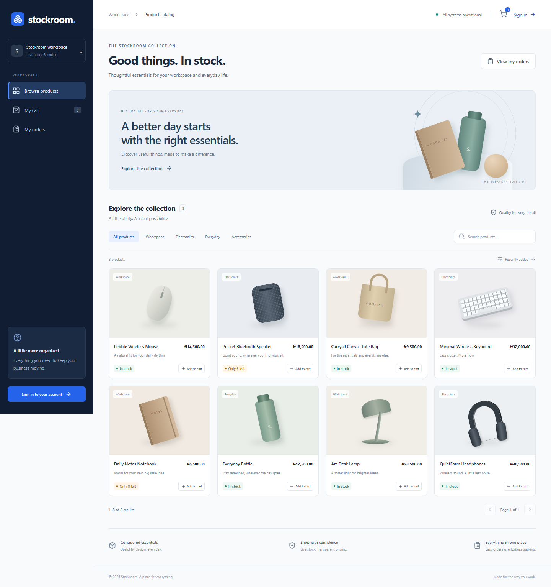
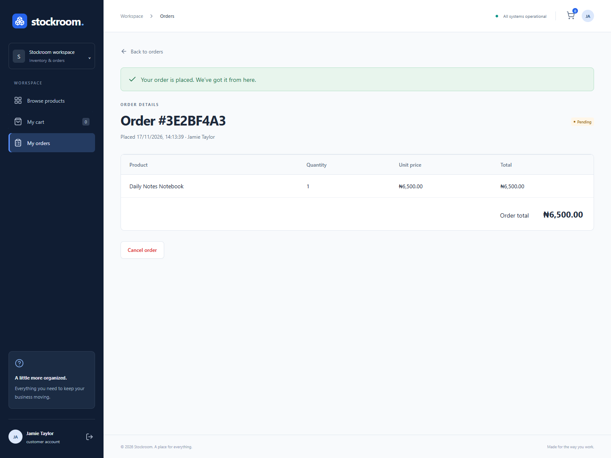
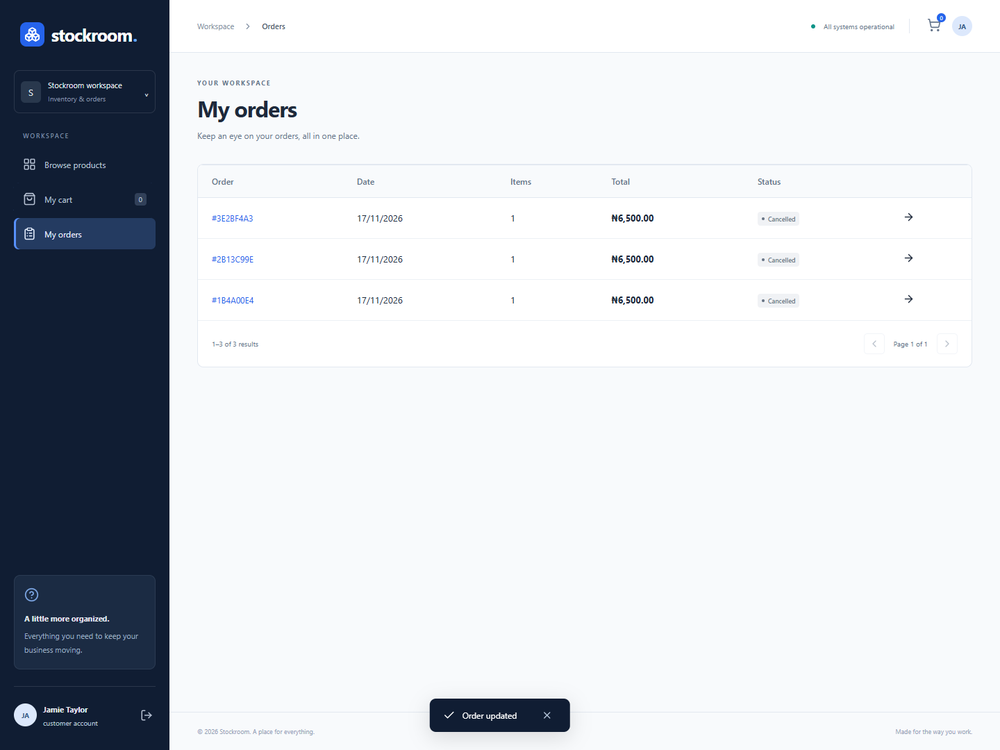
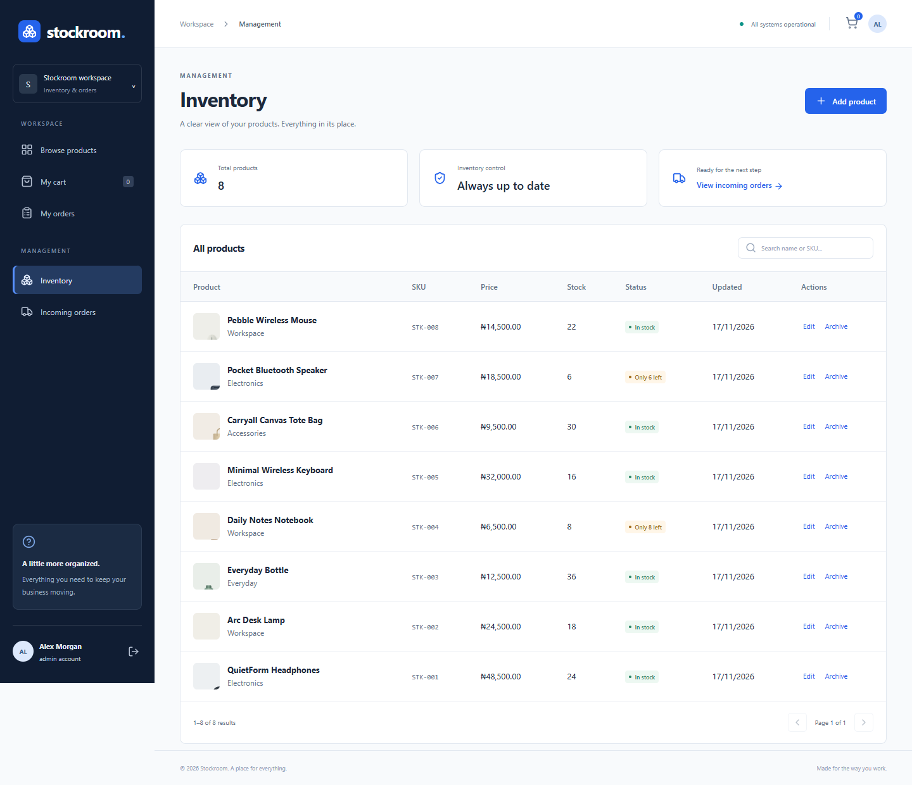
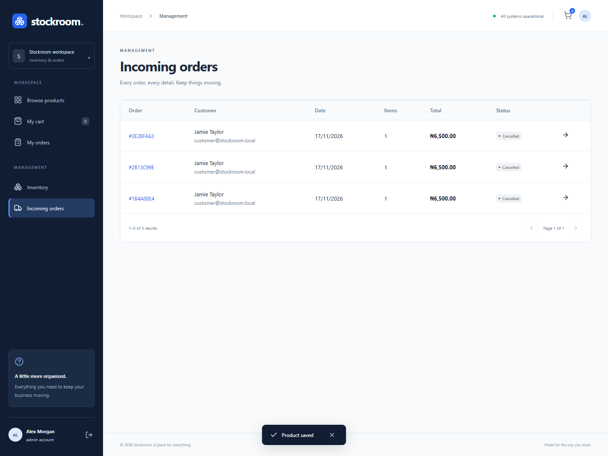
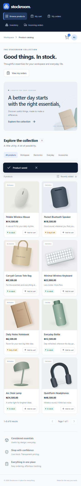
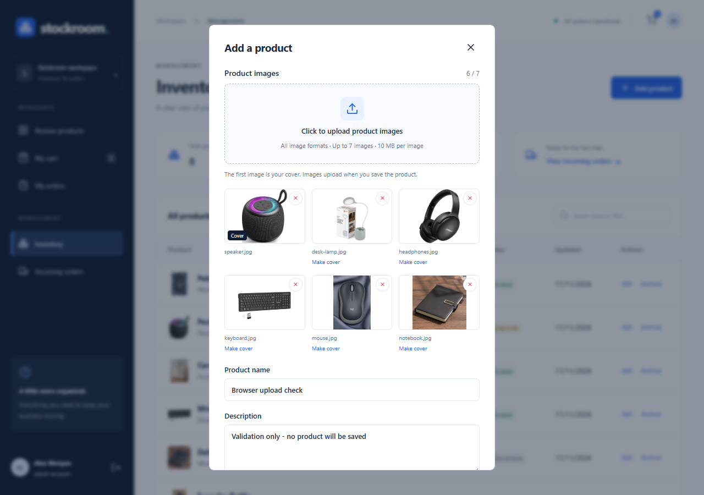
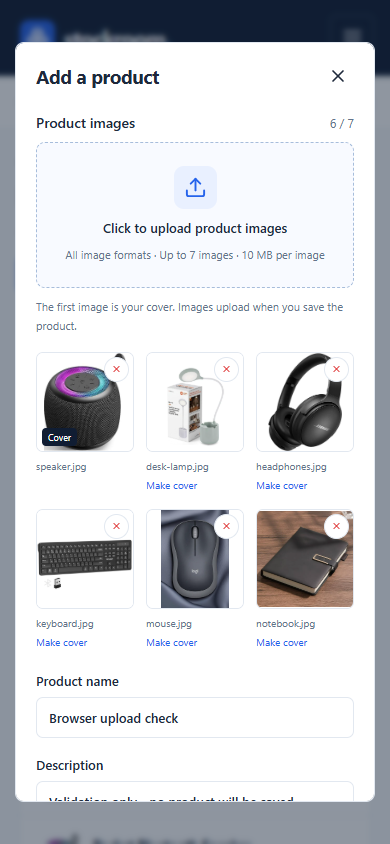

# Verification — 17 November 2026

Verified against the supplied PostgreSQL connection, without exposing its credentials.

- Initial committed migration applied successfully, including relational indexes and
  monetary, quantity and stock CHECK constraints.
- Idempotent seed created eight products plus local customer/admin accounts.
- Production builds succeeded for NestJS and Vite/React.
- TypeScript strict checks and ESLint passed for the API and web application.
- Fourteen PostgreSQL integration tests passed using a unique temporary schema, which
  was removed after execution. Application tables were not reset.
- Chrome verified catalog rendering, cart, customer login/checkout, cancellation/history,
  admin login/product edit/incoming orders, and mobile rendering without horizontal overflow.
- The browser check creates a real demo order and cancels it to restore inventory. These
  cancelled demo orders intentionally remain visible in the seeded customer's history.
- Dependency audit reported zero vulnerabilities after patching Prisma tooling transitive
  dependencies using root overrides. Keep these overrides until upgrading Prisma.

## Screenshots

### Customer catalog

### Customer order

### Customer history

### Administrator inventory

### Administrator orders

### Mobile catalog

## Remaining external handover

### Product image upload and carousel update

- Added Cloudinary server-side uploads and the root environment variable placeholders.
  Credentials remain blank; no live Cloudinary upload could be verified.
- Applied the gallery migration while preserving the supplied local product photos.
- All 21 unit/integration tests passed, including multipart upload authorization, the
  seven-image limit, persisted gallery order, and provider error/cleanup scenarios.
  Cloudinary SDK calls are mocked in tests; PostgreSQL persistence is tested directly.
- Chrome verified image selection, seven previews, rejection of an eighth image, removal,
  cover selection, error recovery when credentials are missing, and the mobile dialog.
- Chrome verified carousel auto-rotation, next/previous navigation, wraparound, dots,
  pause control, mobile controls, and static single-image cards using response fixtures.
  No product records were changed by those browser checks.

Public GitHub publishing and recruiter submission need a destination repository and an
authenticated account. No remote publication or external message was performed. The optional
Go reporting service is deferred as documented in the README.
